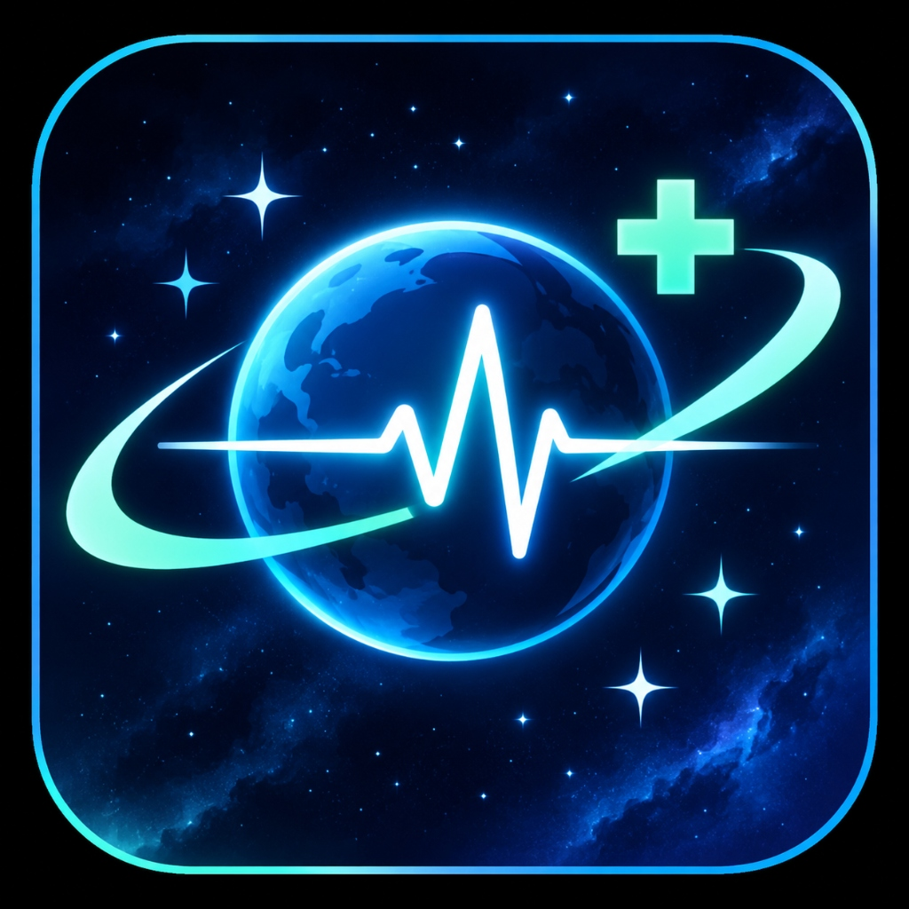

<p align="center">
  
</p>

<h1 align="center">Astro Med-X</h1>

<p align="center">
  <strong>Spaceflight Autonomous Medical Monitoring & Clinical Decision Support System</strong><br>
  NASA Human Research Program (HRP) Compliant • Jetpack Compose • Offline Telemetry Engine
</p>

<p align="center">
  <a href="release/AstroMed-X.apk"><strong>Download Latest APK (v1.0.0-beta)</strong></a> •
  <a href="#quick-installation-guide-for-testers">Installation Guide</a> •
  <a href="#how-to-test--explore-the-app">Testing Guide</a> •
  <a href="#key-capabilities">Key Features</a>
</p>

---

## 📱 Quick Installation Guide for Testers

Testers do **not** need Android Studio or developer tools. You can install and test directly on any Android phone or tablet (Android 7.0 / API 24+):

### Method A: Direct Install on Android Device (Recommended)
1. **Download APK**: Tap [**`release/AstroMed-X.apk`**](release/AstroMed-X.apk?raw=true) directly on your device's browser.
2. **Open the Download**: When finished, tap the notification or locate `AstroMed-X.apk` in your device's **Files / Downloads** app.
3. **Allow Installation (If Prompted)**:
   - Android will prompt: *"For your security, your device is not allowed to install unknown apps from this source"*.
   - Tap **Settings** in the popup.
   - Toggle **Allow from this source**.
4. **Complete Setup**: Tap **Install**, then **Open**.

### Method B: Via ADB / USB (For Developers)
```bash
# Clone the repository
git clone https://github.com/anashenastray/Astro-Med-X.git
cd Astro-Med-X

# Install the pre-compiled APK directly
adb install release/AstroMed-X.apk

# Launch the app
adb shell am start -n com.example.astrohealix/com.example.astromerged.MainActivity
```

---

## 🚀 How to Test & Explore the App

Astro Med-X features a **Built-in Mission Simulator** and deterministic offline engine so testers can evaluate clinical alerts, 24-hour telemetry unrolls, and organ system risk models without external medical hardware:

1. **Trigger Anomaly Scenarios**:
   - In the top header of the **Dashboard**, tap the status badge (e.g., `DONKI: NOMINAL`).
   - Select any scenario to watch the UI instantly adapt in real time:
     - **Nominal Cruise**: Baseline vitals, steady respiratory and cardiovascular rates.
     - **Solar Radiation Event**: Triggers dosimeter spike alerts, deep-space shelter protocols, and antioxidant countermeasures.
     - **Cardio Spike EVA**: Simulates extravehicular workload with tachycardia, high metabolic flux, and SpO2 delta warnings.
     - **Hypercapnia Tachycardia**: Elevated module $\text{pCO}_2$ (>3.0 mmHg) simulating scrubber saturation and compensatory ventilation.
     - **Sensor Disconnect**: Simulates bio-sensor telemetry loss, switching to autonomous estimations and grey unavailable states.

2. **Interactive Vitals & Telemetry Unroll**:
   - Tap any vital card (Heart Rate, Blood Pressure, $\text{SpO}_2$, $\text{pCO}_2$, Radiation Dose) to open full 24H / 7D / 30D historical telemetry graphs with dynamic baseline thresholds.
   - Tap **Quick Log** to add manual fluid intake (+500 mL) or crew symptoms.

3. **3D Anatomical Body Map**:
   - Switch to the **Body Map** tab in the dock.
   - Tap hotspot rings across Cardiovascular, Respiratory, Neurological/SANS, and Musculoskeletal zones to review spaceflight deconditioning risks and prescribed countermeasure hardware (ARED, CEVIS, T2).

4. **Clinical Protocols & Flight Surgeon Delta Log**:
   - Navigate to the **Protocols** tab to step through interactive emergency medical checklists.
   - Tap **Copy Log** or **Share to Flight Surgeon** to export the encrypted telemetry report.

5. **Google OAuth & Settings**:
   - Tap the crew profile avatar in the top left to configure crew identity, Gemini API keys, or authenticate via Google OAuth 2.0 with custom deep-link callbacks (`com.example.astromerged:/oauth2redirect`).

---

## ⚡ Key Capabilities

- **Nordic Light Medical Palette**: Ergonomic high-contrast design system optimized for long-duration space mission display readability, low cognitive load, and reduced eye fatigue.
- **Deterministic Safety Interlock Engine**: Dual-layer clinical evaluation combining baseline delta threshold monitoring with autonomous triage logic.
- **Offline-First Resilience**: Zero dependencies on continuous Earth connectivity; handles deep-space communications latency and solar conjunction blackouts seamlessly.
- **Adaptive Spaceflight Ergonomics**: Generous touch targets and clean layout transitions tailored for gloved interaction and microgravity hand tremors.

---

## 🛠️ Building from Source

```bash
# Build debug APK
./gradlew assembleDebug

# Run unit tests
./gradlew test
```

Compiled APK is generated at:
```
app/build/outputs/apk/debug/app-debug.apk
```

---

## 📄 License & NASA Space Apps Challenge
Developed for Human Exploration & Spaceflight Medical Operations.
Licensed under the Apache License, Version 2.0.
